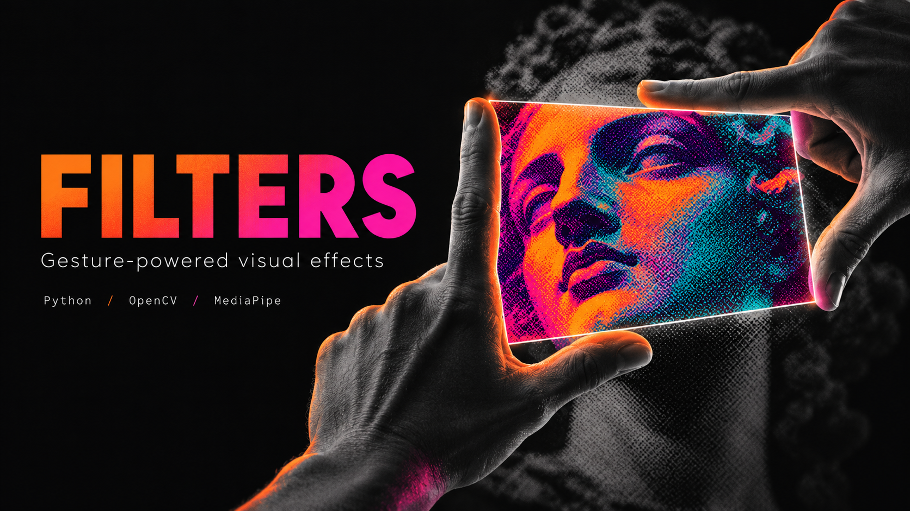

# Filters



**Transforme o espaço entre suas mãos em um portal de efeitos visuais.**

Aplicativo de câmera em Python que rastreia duas mãos e aplica oito filtros dentro de um portal. Aproxime as mãos para trocar de efeito e afaste-as para preparar a próxima troca.

> A capa é uma ilustração conceitual gerada por IA, não uma captura do aplicativo.

## Recursos

- Rastreamento de duas mãos com MediaPipe.
- Portal delimitado pelas pontas dos polegares e indicadores.
- Oito filtros aplicados somente à região do portal.
- Troca por gesto com histerese para reduzir mudanças repetidas.
- Botão **Encerrar**, tecla **Q** e fechamento pelo **X** da janela.
- Processamento local dos quadros; o aplicativo não implementa gravação ou transmissão de vídeo.

## Filtros

| Efeito | Aparência |
| --- | --- |
| Grade | Linhas sobrepostas à imagem |
| Duotone | Cores segmentadas por luminosidade |
| Pontos P&B | Retícula de pontos em preto e branco |
| Aberração cromática | Separação dos canais de cor |
| Térmico | Mapa de cores térmicas |
| Vintage | Sépia, vinheta e granulação |
| Vidro fosco | Desfoque com camada branca |
| Rosa | Retícula em tons rosa e magenta |

## Instalação no Windows

Requisitos: webcam disponível, Python 3.11 de 64 bits e acesso à internet para instalar as dependências. O ambiente verificado usou Python 3.11.0.

Baixe ou clone este repositório. Abra o terminal na pasta que contém `main.py` e execute:

```powershell
py -3.11 -m venv .venv
.\.venv\Scripts\python.exe -m pip install -r requirements.txt
```

Depois, dê dois cliques em **Iniciar-Filters.cmd** ou execute:

```powershell
.\.venv\Scripts\python.exe main.py
```

O iniciador desta pasta usa o ambiente `.venv` local. Ele não depende da instalação original deste computador.

## Como usar

1. Abra o aplicativo e mantenha as duas mãos visíveis à câmera.
2. Forme uma moldura com os indicadores e polegares para delimitar o portal.
3. Aproxime as mãos para avançar ao próximo filtro.
4. Afaste-as antes de repetir o gesto.
5. Clique em **Encerrar**, pressione **Q** ou feche a janela para sair.

O rastreamento depende da iluminação e da visibilidade das mãos. A câmera padrão é a de índice `0` em `main.py`.

## Estrutura

```text
Filters-GitHub/
├── assets/cover.png       # Capa conceitual original
├── main.py                # Captura, rastreamento e interface
├── filters.py             # Oito efeitos e sua ordem
├── geometry.py            # Portal e detector de fechamento
├── hand_tracking.py       # Índices dos landmarks e utilitário de dedos
├── requirements.txt       # Dependências do projeto original
├── Iniciar-Filters.cmd    # Iniciador portátil para Windows
├── graphify-out/          # Mapa estático do código
└── README.md
```

O fluxo principal usa os índices dos dedos de `hand_tracking.py`. A função auxiliar `get_extended_fingers` está disponível, mas não é chamada pelo aplicativo atual.

## Verificação

Na sessão de preparação, a instalação original passou por `pip check`, verificações dos oito filtros, geometria, histerese e inferência do MediaPipe. O aplicativo também abriu a câmera e uma janela responsiva no Windows. O encerramento por botão foi validado com clique simulado.

Esses resultados se referem ao ambiente local, não a uma matriz de compatibilidade. Não há suíte oficial de testes no repositório original. As dependências, exceto MediaPipe, não estão fixadas; instalações futuras podem resolver versões diferentes.

## Problemas comuns

- **Câmera não abre:** feche outros programas que estejam usando a webcam e confira as permissões do Windows.
- **Ambiente não encontrado:** execute os comandos de instalação antes de abrir o iniciador.
- **Gestos não reconhecidos:** melhore a iluminação e mantenha ambas as mãos inteiras no quadro.
- **Avisos de MediaPipe ou Protobuf:** foram observados avisos não fatais no ambiente verificado; uma exceção ou fechamento inesperado deve ser investigado separadamente.

## Origem e alterações

Baseado em [mishu006/Filters](https://github.com/mishu006/Filters), commit `23706a03906e0d6246dc6a843da33760e59494c6`.

Esta versão inclui título de janela, botão Encerrar, tratamento do fechamento pelo X, fechamento do MediaPipe ao sair normalmente, iniciador portátil, documentação em português e capa original. Os créditos do projeto de origem permanecem com seus autores.

### Licença

O README original declara licença MIT, mas o clone usado nesta preparação não contém um arquivo `LICENSE`. Esta pasta não inventa termos nem titulares de direitos; confirme o texto da licença com o projeto de origem antes de redistribuir sob uma licença específica.

## Mapa do código

O [relatório Graphify](graphify-out/GRAPH_REPORT.md) descreve 27 elementos, 66 relações e quatro comunidades. Abra `graphify-out/graph.html` no navegador para explorar o mapa; `graph.json` contém os dados. A análise estática cobriu os quatro arquivos Python, sem análise da capa ou do README. Relações marcadas como inferidas não comprovam execução em tempo real.
